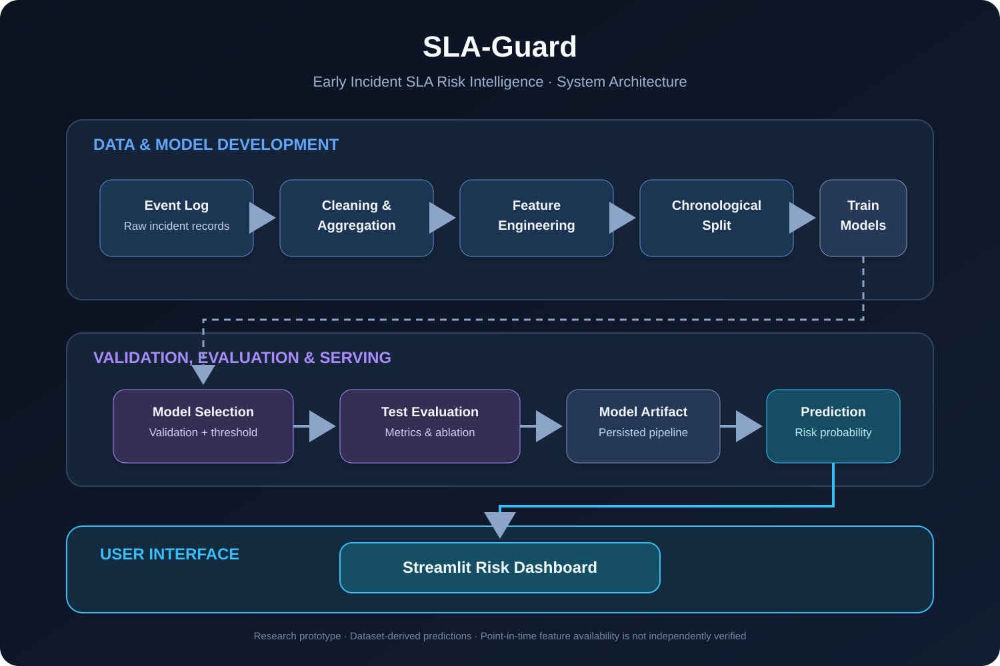

# SLA-Guard
### Early Incident SLA Risk Intelligence

SLA-Guard is a machine learning project designed to predict the likelihood of IT incidents violating their Service Level Agreements (SLAs). It explores how machine learning can help IT support teams identify potentially high-risk incidents and prioritize intervention.

---

## Problem Statement

IT service teams manage large volumes of incidents, each with different urgency, priority, complexity and resolution requirements. Delayed handling of certain incidents can result in SLA violations.

SLA-Guard explores a predictive approach to identify incidents that may be at risk of breaching their SLA, enabling proactive prioritization and data-driven decision support.

## Project Objectives

- Predict the likelihood of an IT incident breaching its SLA.
- Explore incident-related features that contribute to predictive performance.
- Compare multiple machine learning models.
- Optimize the classification threshold using validation data.
- Analyze model performance under chronological data splitting.
- Investigate the contribution of different feature groups.
- Provide an interactive dashboard for incident-level predictions and model analysis.

---

## System Architecture



---

## Dashboard Preview

### Overview


### Risk Prediction


### Model Insights


### Model Evaluation


---

## Key Features

- Incident-level data processing from event logs.
- Feature engineering and preprocessing.
- Chronological train-validation-test splitting.
- Logistic Regression, Random Forest and Gradient Boosting comparison.
- Validation-based decision threshold selection.
- Precision-Recall AUC, ROC-AUC, Precision, Recall, F1-score, Balanced Accuracy and Brier Score evaluation.
- Feature ablation experiments.
- Individual incident risk prediction.
- Interactive Streamlit dashboard.

---

## Tech Stack

| Technology | Purpose |
|---|---|
| Python | Core programming language |
| Pandas | Data processing |
| NumPy | Numerical computation |
| Scikit-learn | Machine learning and evaluation |
| Streamlit | Interactive dashboard |
| Plotly | Data visualization |
| Joblib | Model serialization |

---

## Machine Learning Pipeline

1. Data preprocessing
2. Incident-level aggregation
3. Feature engineering
4. Chronological train-validation-test splitting
5. Model training
6. Model selection using validation data
7. Threshold optimization
8. Final test evaluation
9. Incident-level risk prediction
10. Interactive dashboard

---

## Models Evaluated

- Logistic Regression
- Random Forest Classifier
- Gradient Boosting Classifier

Models are compared using validation performance. Final model selection is based on validation PR-AUC.

---

## Dataset

**Dataset:** UCI Incident Management Process Enriched Event Log

The dataset consists of event records associated with IT service management incidents.

### Target Variable

The target is derived from the `made_sla` field:

- `1` – SLA breach
- `0` – SLA met

Event records are aggregated into incident-level samples, using an initial-event snapshot for features and the incident's final recorded SLA outcome for the target.

### Dataset Overview

| Property | Value |
|---|---:|
| Original event records | 141,712 |
| Unique incidents | 24,918 |
| SLA met | 15,803 |
| SLA breaches | 9,115 |
| Incident-level breach rate | 36.58% |

---

## Feature Engineering

The model uses incident-related features such as:

- Contact type
- Location
- Category
- Subcategory
- Symptom
- Impact
- Urgency
- Priority
- Assignment group
- Knowledge indicator

Additional temporal features:

- Opened month
- Opened weekday
- Opened hour

Categorical variables are processed using imputation and one-hot encoding.

---

## Experimental Methodology

### Chronological Train-Validation-Test Split

The dataset is split chronologically to better simulate predicting future incidents from past data.

| Dataset | Percentage |
|---|---:|
| Training | 70% |
| Validation | 15% |
| Test | 15% |

The validation set is used for model comparison and decision threshold selection. The test set is reserved for final performance evaluation.

### Evaluation Metrics

- **PR-AUC:** Evaluates precision-recall performance, particularly useful for classification with imbalanced classes.
- **ROC-AUC:** Measures the model's ability to distinguish between the two classes.
- **Precision:** Proportion of predicted breaches that are actual breaches.
- **Recall:** Proportion of actual breaches detected by the model.
- **F1-score:** Harmonic mean of precision and recall.
- **Balanced Accuracy:** Average of recall across both classes.
- **Brier Score:** Measures the accuracy of probabilistic predictions.

---

## Test Performance

The selected model was Logistic Regression, chosen based on validation PR-AUC.

| Metric | Test Result |
|---|---:|
| PR-AUC | 0.5229 |
| ROC-AUC | 0.7687 |
| Precision | 0.4089 |
| Recall | 0.7314 |
| F1-score | 0.5246 |
| Balanced Accuracy | 0.7042 |
| Brier Score | 0.1496 |
| Decision Threshold | 0.18 |

The model demonstrates the ability to identify a substantial proportion of SLA-breaching incidents at the selected threshold, while balancing precision and recall.

### Model Comparison

| Model | Test PR-AUC | Test ROC-AUC | Test Recall |
|---|---:|---:|---:|
| Logistic Regression | 0.5229 | 0.7687 | 0.7314 |
| Random Forest | 0.5311 | 0.7848 | 0.7760 |
| Gradient Boosting | 0.5337 | 0.7797 | 0.7634 |

Model selection was based on validation PR-AUC, not test performance. Logistic Regression was selected because it achieved the highest validation PR-AUC, although the differences between models were small.

---

## Feature Ablation Analysis

Feature ablation experiments were conducted to explore the contribution of different feature groups.

| Feature Configuration | Validation PR-AUC | Test PR-AUC |
|---|---:|---:|
| Full Model | 0.5545 | 0.5229 |
| Full minus Metadata | 0.5610 | 0.5321 |
| Full minus Temporal | 0.5598 | 0.5333 |
| Full minus Symptom | 0.5543 | 0.5241 |
| Full minus Priority | 0.5107 | 0.4837 |
| Metadata Only | 0.4121 | 0.4038 |
| Symptom Only | 0.3468 | 0.3409 |
| Priority Only | 0.2859 | 0.2913 |
| Temporal Only | 0.2678 | 0.2656 |

The experiments suggest that different feature groups contribute differently to predictive performance. The results are exploratory and should not be interpreted as causal evidence.

For a more detailed evaluation, see [EVALUATION.md](docs/EVALUATION.md).

---

## Dashboard

The Streamlit dashboard provides four main sections:

### 1. Overview

Introduces the project, problem statement, pipeline and dataset.

### 2. Risk Prediction

Allows users to input incident attributes and obtain:

- Predicted SLA breach probability
- Risk categorization
- Prediction decision
- Model decision threshold

### 3. Model Insights

Provides information about feature-level model insights and influential encoded features.

### 4. Model Evaluation

Displays model performance comparisons, evaluation metrics and ablation results.

---

## Project Structure

```text
SLA-Guard/
├── artifacts/
├── data/
│   ├── raw/
│   └── processed/
├── docs/
│   ├── EVALUATION.md
│   ├── sla_guard_architecture.svg
│   └── screenshots/
├── reports/
│   ├── metrics.json
│   ├── ablation_results.csv
│   └── ablation_results.json
├── sla_guard/
│   ├── cli.py
│   ├── config.py
│   ├── data.py
│   ├── evaluate.py
│   ├── features.py
│   ├── train.py
│   ├── ablation.py
│   └── predict.py
├── tests/
├── api.py
├── app.py
├── LICENSE
├── requirements.txt
├── README.md
└── .gitignore
```

---

## Installation and Execution

### 1. Clone the repository

```bash
git clone https://github.com/YOUR_USERNAME/SLA-Guard.git
cd SLA-Guard
```

### 2. Create a virtual environment

```bash
python -m venv .venv
```

### 3. Activate the virtual environment

**Windows PowerShell:**

```powershell
.venv\Scripts\Activate.ps1
```

### 4. Install dependencies

```bash
pip install -r requirements.txt
```

### 5. Run the dashboard

```bash
streamlit run app.py
```

The dashboard will open in your browser.

---

## Limitations

- The initial-event snapshot is used as a proxy for information available at prediction time. The dataset does not independently establish the real-world availability of every feature at the exact prediction moment.
- The dataset exhibits temporal distribution shift between the training period and later validation/test periods.
- The selected classification threshold is optimized on validation data and may not represent the optimal threshold for every operational environment.
- Risk categories are heuristic probability bands and have not been independently operationally validated.
- Model associations and feature importance do not establish causation.
- Predictions should be used as decision-support signals rather than guarantees of SLA violations.

---

## Future Improvements

- Validate feature availability using a real-time incident prediction scenario.
- Develop a cost-sensitive threshold based on operational intervention costs.
- Improve probability calibration.
- Investigate temporal drift and model monitoring.
- Evaluate on a more recent or external incident dataset.
- Integrate predictions into a real incident management workflow.
- Add explainability techniques such as SHAP.

---

## Project Status

- [x] Data preprocessing
- [x] Incident-level aggregation
- [x] Feature engineering
- [x] Chronological splitting
- [x] Model training
- [x] Model comparison
- [x] Threshold optimization
- [x] Test evaluation
- [x] Feature ablation
- [x] Prediction pipeline
- [x] Interactive dashboard
- [x] System architecture documentation
- [x] Dashboard screenshots

---

**SLA-Guard — Predictive intelligence for proactive IT incident management.**
